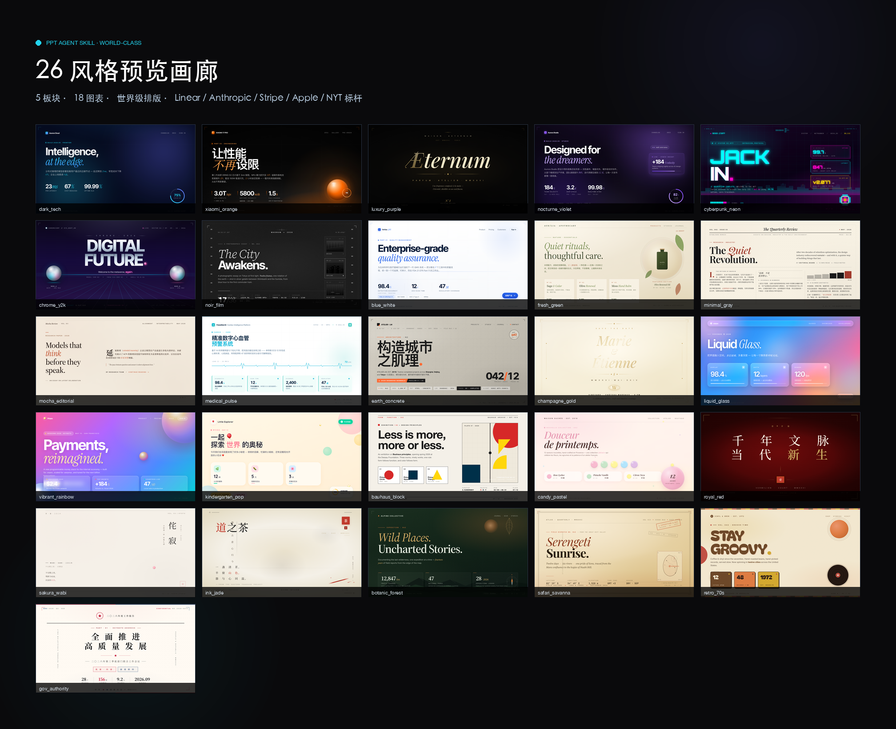
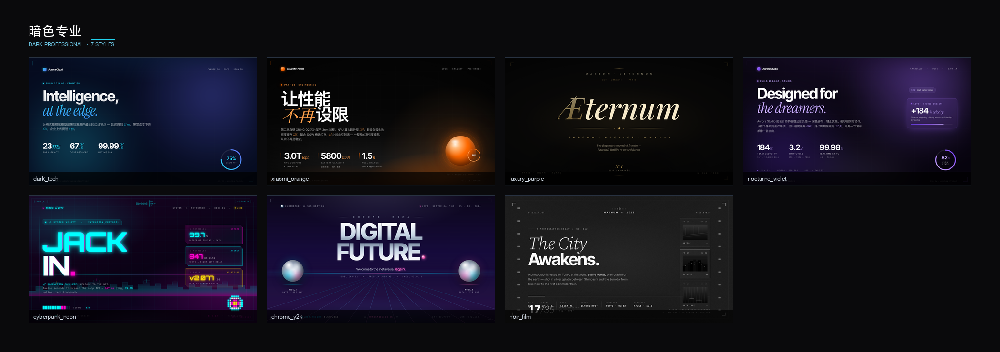
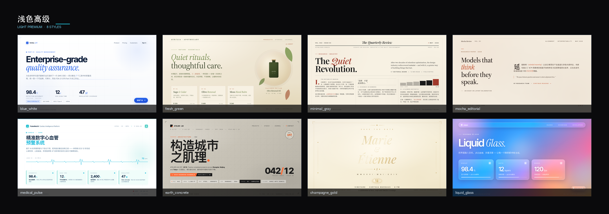
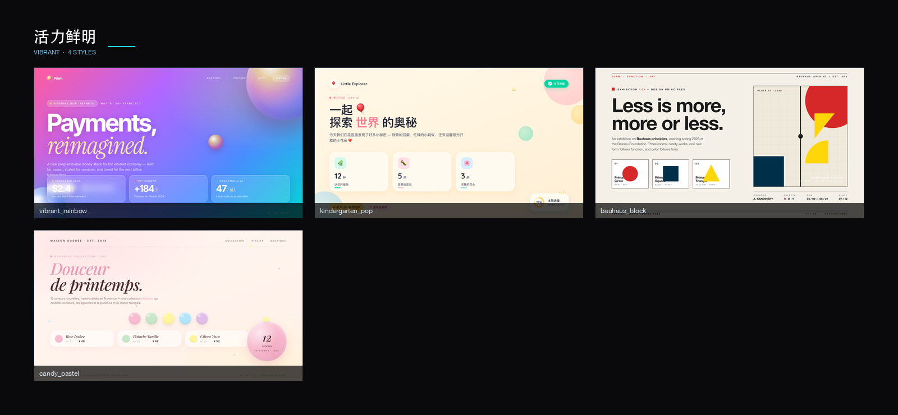
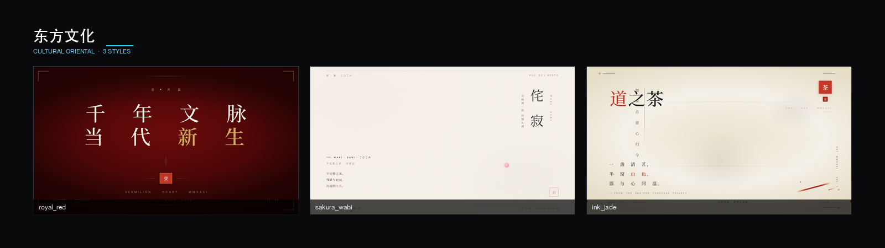
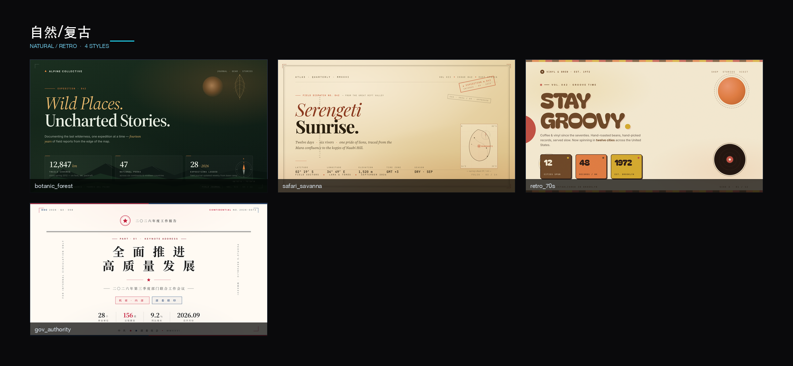
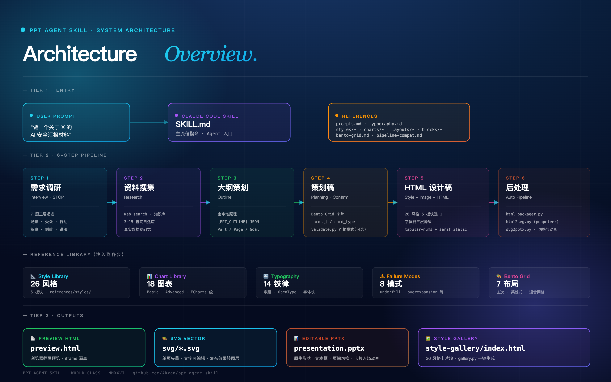

<div align="center">
  

  <h1>PPT Agent Skill</h1>

  <p><strong>世界级 AI 演示文稿生成系统</strong> · 把一句话变成 PPT 设计公司级别的成品</p>

  <p>
    <a href="README_EN.md">English</a> ·
    <a href="#-快速开始">快速开始</a> ·
    <a href="https://akxan.github.io/ppt-agent-skill/">在线画廊</a> ·
    <a href="#-26-风格预览画廊">风格画廊</a> ·
    <a href="#-工作流">工作流</a> ·
    <a href="#-架构">架构</a>
  </p>

  <p>
    
    
    
    
  </p>

  <p>
    <a href="https://github.com/Akxan/ppt-agent-skill/stargazers"></a>
    <a href="https://github.com/Akxan/ppt-agent-skill/network/members"></a>
    <a href="https://github.com/Akxan/ppt-agent-skill/watchers"></a>
    <a href="https://github.com/Akxan/ppt-agent-skill/issues"></a>
  </p>

  <p>
    <a href="LICENSE"></a>
    
    
    
    
    
    
    
  </p>

  <p>
    <strong>对标</strong>
    <code>Linear</code> · <code>Anthropic</code> · <code>Stripe</code> · <code>Apple</code> · <code>NYT Magazine</code> · <code>Tom Ford</code> · <code>Pitch</code> · <code>Mercury</code> · <code>Vercel</code>
  </p>
</div>

---

<div align="center">
  
  <p><sub>26 个世界级风格 · 5 板块覆盖所有商业场景 · 真实 1280×720 标杆 mock</sub></p>
</div>

---

## 💡 这是什么？

一个 **Claude Code Skill**，模拟万元/页 PPT 设计公司的完整工作流，把一句话变成专业级演示文稿（HTML 预览 + 带切换动画的可编辑 PPTX）。

不是"给个大纲套模板"，而是**先调研后生成 / 内容驱动版式 / 全局风格一致 / 真实数据填充**的完整管线。

每个风格的视觉水准对标实际世界级品牌的官网/产品页排版做法（**不是参考截图，是参考实际 CSS 实现**）：字距铁律 / tabular-nums / OpenType 特性 / serif italic 混排 / 字体栈三层降级。

## 🎨 核心特性

| 特性 | 说明 |
|------|------|
| **6 步 Pipeline** | 需求调研 → 资料搜集 → 大纲策划 → 策划稿 → HTML 设计稿 → 后处理（SVG + PPTX）|
| **26 种世界级风格** | 5 板块覆盖：暗色专业 7 / 浅色高级 8 / 活力鲜明 4 / 东方文化 3 / 自然复古 4 |
| **18 种数据可视化** | 基础 8 + 进阶 6（雷达/时间线/漏斗/仪表盘）+ ECharts 级 4（世界地图/关系网络/桑基/热力日历）|
| **Bento Grid 布局** | 7 种基础布局 + 3 种扩展版式，内容驱动版式 |
| **世界级排版** | 7 级字号阶梯 · 字距铁律 · tabular-nums · OpenType 特性 · serif italic 混排 · 字体栈三层降级 |
| **智能配图** | AI 生成配图 + 5 种视觉融入技法（渐隐融合/色调蒙版/氛围底图等）|
| **失败模式目录** | 8 种 failure modes（underfill / decorative_substitution 等）+ 修复顺序铁律 |
| **跨页叙事** | 密度交替节奏 / 章节色彩递进 / 封面-结尾呼应 / 渐进揭示 |
| **风格预览画廊** | `gallery.py` 一键生成 26 风格卡片墙索引页，[在线查看](https://akxan.github.io/ppt-agent-skill/) |
| **可编辑 PPTX** | 文字是文本框、图形是原生形状、卡片是组合；径向背景、光晕等复杂效果自动转成图层保真 |
| **切换与动画** | 默认页间淡入；可选卡片逐张入场（点击或自动），在 PowerPoint 中实测可用，浏览器预览页也能播放同样的动效 |
| **严格模式** | 可选：`validate.py` 在每步后校验大纲、策划稿、风格、设计稿与截图 |
| **Smoke 测试** | `smoke_test.py` 覆盖风格、mock、图表、校验器、文档引用与真实导出 |

## 🚀 快速开始

**安装**：把仓库克隆到 Claude Code 的 skills 目录，然后新开一个会话。

```bash
# 个人级：所有项目可用
git clone --depth 1 https://github.com/Akxan/ppt-agent-skill ~/.claude/skills/ppt-agent-skill

# 或项目级：只在当前项目可用（在项目根目录执行）
git clone --depth 1 https://github.com/Akxan/ppt-agent-skill .claude/skills/ppt-agent-skill
```

**使用**：装好后直接说需求，Skill 会自动触发：

```
你：帮我做一个关于 X 的 PPT
  ↓
Agent 提问调研需求（等你回复 7 题）
  ↓
自动搜索资料 → 生成大纲 → 策划稿 → 逐页设计 HTML
  ↓
自动后处理：HTML → SVG → PPTX
  ↓
全部产物保存到 ppt-output/
```

**触发示例**：

| 场景 | 说法 |
|------|------|
| 纯主题 | `做一个关于 X 的 PPT` / `做一个 Y 的演示` |
| 带素材 | `把这篇文档做成 PPT` / `用这份报告做 slides` |
| 带要求 | `做 15 页暗黑科技风的 AI 安全汇报材料` |
| 隐式触发 | `我要给老板汇报 Y` / `做个培训课件` / `做路演 deck` |

**环境依赖**（只有导出 SVG / PPTX 时需要；缺少时仍会交付 HTML 预览）：

```bash
# Python >= 3.9
pip install python-pptx lxml Pillow

# Node.js >= 18；puppeteer 在首次运行 html2svg.py 时自动安装（会下载 Chrome，约 600 MB）
```

## 🎨 26 风格预览画廊

5 个板块，覆盖所有典型商业场景。每个 mock 都是真实 1280×720 设计稿，可以在[在线画廊](https://akxan.github.io/ppt-agent-skill/)里逐个点开看：

### 暗色专业（7 风格 · `references/styles/dark.md`）

<div align="center">
  
</div>

> Linear / Apple Hardware / Tom Ford / Cyberpunk 2077 / Y2K / Magnum 等品牌的实际排版做法

| ID | 灵感 | 适用场景 |
|----|------|---------|
| `dark_tech` | Linear.app | AI / SaaS / 开发者工具 |
| `xiaomi_orange` | Apple Keynote 硬件版 | 硬件 / IoT / 汽车发布 |
| `luxury_purple` | Tom Ford | 奢侈品 / 高端品牌 |
| `nocturne_violet` | Linear 紫光版 | 设计师 SaaS / 创业产品 |
| `cyberpunk_neon` | Cyberpunk 2077 | 电竞 / 游戏 / Web3 |
| `chrome_y2k` | Y2K / Vaporwave | Web3 / 千禧年复古 |
| `noir_film` | Magnum / 黑白纪录片 | 纪录片 / 影像艺术 / 摄影 |

### 浅色高级（8 风格 · `references/styles/light.md`）

<div align="center">
  
</div>

> Apple / Anthropic / NYT Magazine / iOS 26 / Mayo Clinic / Suisse Int'l / 婚礼请柬

| ID | 灵感 | 适用场景 |
|----|------|---------|
| `blue_white` | Apple 企业页面 | 企业 SaaS / 培训 / 金融医疗 |
| `fresh_green` | Aesop | 护肤 / 养生 / 食品 / 美妆 |
| `minimal_gray` | NYT Magazine | 学术 / 法务 / 咨询 / 白皮书 |
| `mocha_editorial` | Anthropic / Pantone 2025 | AI 安全研究 / 出版 |
| `medical_pulse` | Mayo Clinic | 医疗 / 医药 / 健康保险 |
| `earth_concrete` | Suisse Int'l | 建筑 / 工业 / 咖啡品牌 |
| `champagne_gold` | 婚礼请柬 | 婚庆 / 宴会 / 颁奖典礼 |
| `liquid_glass` | iOS 26 / visionOS | XR / AR / 苹果生态发布 |

### 活力鲜明（4 风格 · `references/styles/vibrant.md`）

<div align="center">
  
</div>

| ID | 灵感 | 适用场景 |
|----|------|---------|
| `vibrant_rainbow` | Stripe Sessions | 营销 / 创作者 / 大会 |
| `kindergarten_pop` | 高质量儿童绘本 | 儿童教育 / 启蒙 / 亲子 |
| `bauhaus_block` | Bauhaus / Swiss Design | 教育 / 创意品牌 / 独立设计 |
| `candy_pastel` | Ladurée 糖果店 | 甜品 / 烘焙 / 零食 |

### 东方文化（3 风格 · `references/styles/cultural.md`）

<div align="center">
  
</div>

| ID | 灵感 | 适用场景 |
|----|------|---------|
| `royal_red` | 北京冬奥开幕式 | 中国风 / 政务 / 文化 |
| `sakura_wabi` | 日本侘寂 | 日系 / 茶道 / 民宿 |
| `ink_jade` | 新中式国潮 | 茶饮 / 古风文创 / 独立书店 |

### 自然/复古（4 风格 · `references/styles/natural.md`）

<div align="center">
  
</div>

| ID | 灵感 | 适用场景 |
|----|------|---------|
| `botanic_forest` | Patagonia / Nat Geo | 户外 / 可持续 / 林产 |
| `safari_savanna` | National Geographic | 旅行 / 探险 / 纪录片 |
| `retro_70s` | Wes Anderson / 70s 海报 | 独立咖啡 / 唱片 / 复古 |
| `gov_authority` | 人民日报 / 国宴 | 党政 / 重大会议 / 严肃汇报 |

## 📈 18 种数据可视化

| 层级 | 数量 | 图表 | 文件 |
|------|------|------|------|
| **基础** | 8 | 进度条 · 对比柱 · 环形图 · 迷你折线 · 点阵图 · KPI 卡 · 指标行 · 评分 | [`charts/basic.md`](references/charts/basic.md) |
| **进阶** | 6 | 雷达图 · 时间线 · 漏斗图 · 仪表盘 · 多组对比柱 · 简单地理 | [`charts/advanced.md`](references/charts/advanced.md) |
| **ECharts 级** | 4 | 世界地图 choropleth · 关系网络 · 桑基图 · 热力日历 | [`charts/complex.md`](references/charts/complex.md) |

全部纯 HTML/CSS/SVG 实现，**无 JS 运行时**，进 PPTX 后图形与数字仍可编辑。所有图表通过标准 CSS 变量自动适配 26 风格。

## 🔧 工作流

```
┌──────────────┐  ┌──────────────┐  ┌──────────────┐  ┌──────────────┐  ┌──────────────┐  ┌──────────────┐
│  Step 1      │  │  Step 2      │  │  Step 3      │  │  Step 4      │  │  Step 5      │  │  Step 6      │
│  需求调研    │→ │  资料搜集    │→ │  大纲策划    │→ │  策划稿      │→ │  风格+设计稿 │→ │  后处理      │
│              │  │              │  │              │  │              │  │              │  │              │
│  7 题三层    │  │  3-15 查询   │  │  金字塔原理  │  │  Bento Grid  │  │  26 风格选 1 │  │  HTML→SVG    │
│  递进访谈    │  │  自适应      │  │  + 自检      │  │  策划卡      │  │  + 智能配图  │  │  →PPTX       │
└──────────────┘  └──────────────┘  └──────────────┘  └──────────────┘  └──────────────┘  └──────────────┘
   STOP 等回复                                            建议等确认           按 Part 分批         自动执行
```

详细流程见 [`SKILL.md`](SKILL.md)。

## 🏗 系统架构

<div align="center">
  
  <p><sub>3 层架构：用户入口 / 6 步 Pipeline / 输出产物 · 5 大 Reference Library 注入到各步</sub></p>
</div>

**3 层架构**：

- **TIER 1 · 入口** — 用户一句话 prompt 触发 [SKILL.md](SKILL.md)（Agent 入口主流程指令）；引用 `references/` 下的所有规则文件
- **TIER 2 · 6 步 Pipeline** — 每步独立 STEP，前后用 JSON 合同传递；每步可见使用的 reference 文件
- **TIER 3 · 输出** — 翻页 HTML / 矢量 SVG / 可编辑 PPTX（含切换与动画）/ 风格预览画廊

**Reference Library**（注入到各步）：

| 模块 | 数量 | 位置 |
|------|------|------|
| 📐 Style Library | 26 风格 | `references/styles/` (5 板块) |
| 📊 Chart Library | 18 图表 | `references/charts/` (3 层级) |
| 🔤 Typography | 14 铁律 | `references/typography.md` |
| ⚠ Failure Modes | 8 模式 | `references/principles/failure-modes.md` |
| 🎨 Bento Grid | 7 布局 | `references/bento-grid.md` |

## 📂 文件树

```
ppt-agent-skill/
├── .github/workflows/pages.yml   # 把风格画廊自动发布到 GitHub Pages
├── SKILL.md                      # 主工作流指令（Agent 入口）
├── README.md / README_EN.md      # 本文件 / English
├── ATTRIBUTIONS.md               # 借鉴来源与致谢
├── assets/                       # README 用图：logo、架构图、风格拼图
├── references/                   # Skill 引用文档（索引见 references/README.md）
│   ├── prompts.md                # 5 套 Prompt 模板
│   ├── bento-grid.md             # 画布、7 种布局、6 种基础卡片
│   ├── typography.md             # 排版铁律 14 条
│   ├── pipeline-compat.md        # 哪些 CSS 保持矢量 / 转图层 / 会丢
│   ├── strict-mode.md            # 可选的脚本校验与图审清单
│   ├── method.md                 # 核心方法论
│   ├── styles/                   # 26 风格：index.md + 5 个板块文件
│   ├── charts/                   # 18 图表：index.md + basic / advanced / complex
│   ├── layouts/                  # 10 种版式
│   ├── blocks/                   # 7 种组件原型 + card-styles
│   ├── page-templates/           # cover / toc / section / end
│   ├── principles/               # 6 条设计原则 + failure-modes
│   └── design-runtime/           # CSS 技法库、数据类型映射
├── scripts/                      # 脚本（索引见 scripts/README.md）
│   ├── html_packager.py          # 多页 HTML → 翻页预览
│   ├── html2svg.py               # HTML → SVG（文字可编辑，复杂效果转图层）
│   ├── svg2pptx.py               # SVG → PPTX（原生形状、切换、入场动画）
│   ├── pptx_motion.py            # 切换与动画的 OOXML 构造
│   ├── html2png.py / png2pptx.py # 像素级保真版 PPTX
│   ├── contracts.py              # 数据合同的单一真源
│   ├── validate.py               # 严格模式校验
│   ├── resource_loader.py        # 按策划稿字段取参考资源
│   ├── smoke_test.py             # 冒烟测试
│   └── gallery.py / build_hero.py# 风格画廊与 README 拼图
└── ppt-output/style-gallery/     # 26 个 1280×720 mock + 截图 + index.html
```

## 🧪 质量保证

```bash
# 快速套件：26 风格定义 / mock 合规 / 18 图表模板 / 校验器 / 资源路由 / 文档引用完整性
python3 scripts/smoke_test.py

# 追加真实导出：HTML → SVG → PPTX，并断言背景、卡片成组、页间切换、入场动画都已写入
python3 scripts/smoke_test.py --export
```

导出质量用真实 PowerPoint 渲染对照浏览器截图验证过 26 个风格。生成 deck 时还可以启用[严格模式](references/strict-mode.md)，在每一步后用 `scripts/validate.py` 校验产物。

## 🌟 世界级标杆参照系

排版做法参考的实际品牌（**不是看截图模仿，是阅读其官网 CSS**）：

| 类别 | 品牌 | 学到了什么 |
|------|------|-----------|
| 暗色 SaaS | [Linear](https://linear.app) | Inter Tight 紧凑字距 + 紫色辉光 + serif italic 关键词混排 |
| AI 编辑器 | [Anthropic](https://anthropic.com) | Mocha Mousse 米色 + Source Serif italic + 砖红强调线 |
| 渐变高级感 | [Stripe](https://stripe.com) | 多层 linear-gradient + 玻璃球（多层 radial-gradient + 内阴影）|
| 极简白 | [Apple](https://apple.com) | SF Pro 字体栈 + 大留白 + 内框线条 |
| 全息镭射 | [OpenAI](https://openai.com) | 纯黑底 + 全息球 + 极简留白 |
| 极致黑白 | [Vercel](https://vercel.com) | Geist Sans + 几何分割 + monospace 终端语义 |
| 杂志感 | NYT Magazine | masthead + 巨型 serif + 三栏分栏 + 首字下沉 |
| 演示工具 | [Pitch](https://pitch.com) | 大胆排版 + 全屏色块 + 拼贴感 |
| 金融 serif | [Mercury](https://mercury.com) | SangBleu serif 大标题 + 极简金融感 |
| 浏览器渐变 | [Arc](https://arc.net) | 渐变彩色 + 圆角图标 + 创意拼贴 |
| 时尚奢华 | Tom Ford | Didot italic + 黑金 + 居中对称 + 0.65em 字距 |
| 友好编辑器 | [Notion](https://notion.so) | Lyon Display + 米白 + emoji 系统 |

## ⭐ Star History

<div align="center">
  <a href="https://star-history.com/#Akxan/ppt-agent-skill&Date">
    <picture>
      <source media="(prefers-color-scheme: dark)" srcset="https://api.star-history.com/svg?repos=Akxan/ppt-agent-skill&type=Date&theme=dark" />
      <source media="(prefers-color-scheme: light)" srcset="https://api.star-history.com/svg?repos=Akxan/ppt-agent-skill&type=Date" />
      
    </picture>
  </a>
  <p><sub>实时生成 · 由 <a href="https://star-history.com">star-history.com</a> 提供 · 自动适配深色/浅色主题</sub></p>
</div>

## 🤝 贡献

欢迎提 Issue / PR：
- **新增风格**：在对应 `references/styles/<category>.md` 追加 JSON 定义 + 在 `ppt-output/style-gallery/<id>.html` 写 1280×720 mock
- **新增图表**：在 `references/charts/<level>.md` 追加 HTML 模板，并在 `scripts/contracts.py` 的 `CHARTS` 登记
- **改进文档**：欢迎 typo 修复、用法说明补充

提交前跑一下 `python3 scripts/smoke_test.py` 确保通过。

## 📜 许可证

[MIT](LICENSE)

---

<div align="center">
  <sub>Built with ❤️ for <a href="https://claude.com/claude-code">Claude Code</a> · MMXXVI</sub>
</div>
